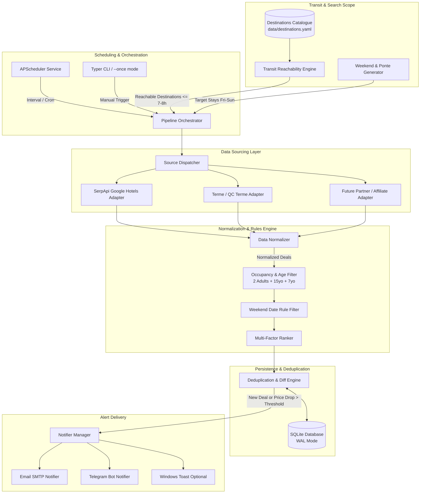
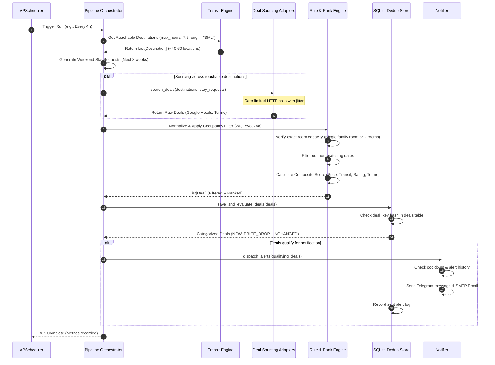
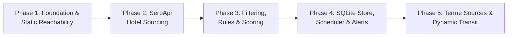

# Architecture Specification: Weekend Getaway Deals (Italy)

**Target Scenario:** Continuous discovery of weekend hotel and thermal-bath (*terme*) deals in Italy for a family of 4 (2 adults + 2 children aged 15 and 7), departing from Santa Margherita Ligure by train or bus within a 7–8 hour travel budget.

---

## 1. System Overview & Architectural Principles

### 1.1 Context and Problem Statement
Finding viable weekend getaways for a family of four departing Santa Margherita Ligure (GE) has distinct constraints that off-the-shelf booking aggregators fail to solve simultaneously:
1. **Public Transit Constraint:** No car or flights. The journey originates at Santa Margherita Ligure–Portofino railway station and must reach the destination within 7 to 8 hours door-to-door using rail (Frecciabianca/Frecciarossa/Intercity/Regionale, Italo) and scheduled local/regional buses.
2. **Strict Family Occupancy Math:** Accommodating 2 adults and 2 children aged 15 and 7 requires either a genuine 4-person family room/suite or two connecting/adjacent rooms. Crucially, Italian hospitality systems routinely classify a 15-year-old as an adult; pricing must never assume child discounts for the 15-year-old. Thermal baths also enforce age restrictions that must not exclude the 7-year-old.
3. **Calendar Alignment:** Stays are weekend-centric (Friday check-in to Sunday check-out, 2 nights), with dynamic 3-night extensions for Italian long weekends (*ponti* and national holidays).
4. **Noise-Free Continuous Execution:** The system runs unattended 24/7 on a home Windows PC (or low-spec VM), polling sources within legal rate limits, tracking price history, and notifying the family only for new deals or substantial price drops.

### 1.2 Core Architectural Principles
* **Decoupled Pipeline:** Source extraction, transit validation, business filtering, ranking, persistence, and notification are distinct stages communicating through typed domain models.
* **Pluggable Data Sources:** Every hotel or spa provider implements an identical adapter contract (`BaseDealSource`). Adding or disabling a source requires zero changes to filters, rankers, or notification logic.
* **Boring, Self-Contained Technology:** Python 3.12, SQLite (with WAL mode), and APScheduler require no external Redis, Docker daemon, or paid database instances. The application boots and runs on standard Windows 11 PowerShell without overhead.
* **Configuration Over Hardcoding:** Origin stations, party ages, travel thresholds, search horizons, budgets, and alert channels live exclusively in structured configuration and environment variables.
* **Hermetic and Deterministic Testing:** Live network calls are strictly banned during tests. All test cases use recorded HTTP fixtures (`respx` / static JSON) and freeze time (`freezegun`).
* **Compliance & Defense-in-Depth:** Scrapers and APIs honor Terms of Service, `robots.txt`, and rate limits. All secrets remain strictly in `.env`.

---

## 2. Recommended Tech Stack & Justifications

| Component | Selected Technology | Version | Justification | Alternatives Evaluated & Rejected |
|---|---|---|---|---|
| **Runtime** | Python | `>=3.12` | Native support on Windows, modern type hinting (`type` aliases, `typing.Self`), high execution speed improvements, robust async ecosystem. | Python 3.10/3.11 (older typing features, slightly slower). |
| **Data Models & Config** | Pydantic & Pydantic Settings | `v2.7+` | Rust-backed validation core provides blazing speed; strict type coercion; native `.env` loading; serialization into SQLite. | `dataclasses` (no built-in parsing/validation), `marshmallow` (slower, verbose). |
| **HTTP Client** | HTTPX | `^0.27.0` | Unified sync and async APIs, native HTTP/2 support, connection pooling, clean mock integration with `respx`. | `requests` (no async support, no HTTP/2), `aiohttp` (different API, harder sync/async duality). |
| **Persistence** | SQLite via SQLAlchemy 2.0 (Core & ORM) + Alembic | `^2.0` | Zero-configuration single-file database ideal for local Windows storage; WAL mode allows concurrent reads; SQLAlchemy 2.0 provides modern typed expressions; Alembic manages versioned schema migrations. | PostgreSQL/MySQL (excessive ops overhead for local daemon), plain `sqlite3` without ORM (error-prone raw SQL, manual migrations). |
| **Scheduler** | APScheduler | `^3.10` | Lightweight in-process scheduler supporting cron, interval, and date triggers with jitter; runs seamlessly in background daemon threads without external brokers. | Celery / RQ (require Redis/RabbitMQ brokers — unnecessary operational complexity for single-node daemon). |
| **Test Framework** | PyTest + Pytest-Asyncio + Respx + Freezegun | `^8.0` | Industry standard; expressive fixtures; `respx` mocks HTTPX requests without network activity; `freezegun` ensures deterministic weekend date calculations. | `unittest` (boilerplate-heavy). |
| **CLI & Operations** | Typer & Structlog | `^0.12` / `^24.1` | Typer gives a clean CLI interface (`run`, `search-once`, `migrate`); Structlog produces human-readable colored logs on Windows PowerShell and structured JSON in production logs. | `argparse` (verbose), standard `logging` (clunky JSON formatting). |

---

## 3. End-to-End System Architecture & Data Flow

### 3.1 Pipeline Stages
The application operates as an event-driven periodic pipeline orchestrated by the **Scheduler**:

```
[ APScheduler Trigger ]
           │
           ▼
[ 1. Stay Request Generator ]
   Generates upcoming weekend dates (Fri-Sun / Long Weekends) within Search Horizon
           │
           ▼
[ 2. Reachable Destination Catalogue ]
   Provides verified destinations <= 7-8h from Santa Margherita Ligure by train/bus
           │
           ▼
[ 3. Pluggable Deal Sourcing Layer ]
   Concurrent queries across adapters (SerpApi Google Hotels, Terme direct, etc.)
   with per-source rate limiting and failure isolation
           │
           ▼
[ 4. Normalization Layer ]
   Harmonizes raw vendor responses into unified Deal objects
           │
           ▼
[ 5. Occupancy & Date Filter ]
   Enforces: 4-person capacity (2A + 15yo + 7yo), room count, Friday-Sunday dates, minimum age restrictions
           │
           ▼
[ 6. Scoring & Ranking Engine ]
   Computes multi-factor value score (price vs budget, discount, transit time, reviews, inclusions)
           │
           ▼
[ 7. Deduplication & Price Store (SQLite) ]
   Records deal snapshot, compares against price history, classifies as NEW, CHEAPER, or UNCHANGED
           │
           ▼
[ 8. Alert Dispatcher (Notifier) ]
   Sends instant alerts (Telegram / Email) for high-value discoveries, accumulates daily digest
```

### 3.2 Mermaid Architecture Diagram



### 3.3 Sequence Diagram of a Scheduled Execution Tick



---

## 4. Core Domain Models & Adapter Interfaces

All domain models are immutable Pydantic v2 classes with strict type checking and serialization capabilities.

### 4.1 Domain Models Specification

```python
"""Core domain models for Weekend Getaway Deals."""

from __future__ import annotations
from datetime import date, datetime
from enum import Enum
from typing import List, Optional
from pydantic import BaseModel, Field, HttpUrl, PositiveInt, NonNegativeFloat, model_validator


class BoardType(str, Enum):
    ROOM_ONLY = "room_only"
    BREAKFAST = "breakfast"
    HALF_BOARD = "half_board"
    FULL_BOARD = "full_board"
    ALL_INCLUSIVE = "all_inclusive"


class DestinationCategory(str, Enum):
    TERME = "terme"
    SPA_RESORT = "spa_resort"
    SEASIDE = "seaside"
    LAKE = "lake"
    MOUNTAIN = "mountain"
    ART_CITY = "art_city"
    COUNTRYSIDE = "countryside"


class TransitMode(str, Enum):
    TRAIN = "train"
    BUS = "bus"
    TRAIN_PLUS_BUS = "train_plus_bus"


class AlertType(str, Enum):
    NEW_DEAL = "new_deal"
    PRICE_DROP = "price_drop"
    DIGEST = "digest"


class PartyComposition(BaseModel):
    """Specific family party: 2 adults, 2 children (15yo and 7yo)."""
    adults: PositiveInt = Field(default=2, description="Number of adults")
    children_ages: List[int] = Field(
        default=[15, 7],
        description="Ages of children. Note: 15-year-old must be treated as adult for pricing."
    )

    @property
    def total_guests(self) -> int:
        return self.adults + len(self.children_ages)

    @property
    def adults_for_pricing(self) -> int:
        """Many Italian systems treat >=14 or >=15 as adult."""
        return self.adults + sum(1 for age in self.children_ages if age >= 14)


class TransitSegment(BaseModel):
    mode: TransitMode
    operator: str = Field(description="e.g. Trenitalia, Italo, Tiemme, AMT")
    departure_station: str
    arrival_station: str
    duration_minutes: PositiveInt
    line_code: Optional[str] = None


class TransitRoute(BaseModel):
    origin: str = Field(default="Santa Margherita Ligure-Portofino")
    destination_name: str
    destination_station: str
    total_duration_minutes: PositiveInt = Field(description="Total door-to-door transit time")
    transfers: int = Field(default=0, ge=0)
    segments: List[TransitSegment] = Field(default_factory=list)
    is_bus_last_mile: bool = Field(default=False)
    bus_frequency_notes: Optional[str] = None
    estimated: bool = Field(default=False, description="True if based on catalogue estimates")

    @property
    def total_hours(self) -> float:
        return round(self.total_duration_minutes / 60.0, 2)


class Destination(BaseModel):
    id: str = Field(description="Unique slug, e.g. 'abano-terme', 'sirmione', 'bologna'")
    name: str
    region: str = Field(description="Italian region, e.g. 'Veneto', 'Toscana'")
    category: DestinationCategory
    primary_station: str = Field(description="Nearest railway station")
    latitude: Optional[float] = None
    longitude: Optional[float] = None
    transit_route: TransitRoute
    has_thermal_baths: bool = Field(default=False)
    minimum_child_age_spa: Optional[int] = Field(
        default=None,
        description="Minimum age admitted into thermal pools/wellness centers if restricted"
    )
    notes: Optional[str] = None


class StayRequest(BaseModel):
    check_in: date
    check_out: date
    party: PartyComposition = Field(default_factory=PartyComposition)
    is_long_weekend: bool = Field(default=False)

    @property
    def nights(self) -> int:
        return (self.check_out - self.check_in).days

    @model_validator(mode="after")
    def validate_dates(self) -> StayRequest:
        if self.check_out <= self.check_in:
            raise ValueError("check_out must be after check_in")
        if self.nights not in (2, 3):
            raise ValueError(f"Weekend stays must be 2 or 3 nights, got {self.nights}")
        return self


class RoomOffer(BaseModel):
    name: str = Field(description="Room title, e.g. 'Family Suite' or '2 x Superior Double'")
    room_count: PositiveInt = Field(default=1, description="Number of rooms booked to fit party")
    max_guests: PositiveInt = Field(description="Total capacity of the room allocation")
    board: BoardType = Field(default=BoardType.ROOM_ONLY)
    terme_included: bool = Field(default=False, description="Thermal spa access included in rate")
    terme_child_policy_compliant: bool = Field(
        default=True,
        description="False if the 7yo is excluded from spa facilities"
    )
    cancellation_policy: Optional[str] = None


class PriceBreakdown(BaseModel):
    total_eur: float = Field(gt=0, description="Total stay price for all 4 persons")
    price_per_night_eur: float = Field(gt=0)
    taxes_included: bool = Field(default=True)
    estimated_tourist_tax_eur: Optional[float] = Field(
        default=None,
        description="Tassa di soggiorno estimated for 2 nights"
    )
    original_price_eur: Optional[float] = Field(
        default=None,
        description="Baseline/strike-through price if on sale"
    )

    @property
    def discount_percent(self) -> Optional[float]:
        if self.original_price_eur and self.original_price_eur > self.total_eur:
            return round((1 - self.total_eur / self.original_price_eur) * 100, 1)
        return None


class Deal(BaseModel):
    id: str = Field(description="Hash fingerprint of source_id + property_id + dates + room")
    source_id: str = Field(description="Source identifier, e.g. 'serpapi_google_hotels'")
    property_id: str
    property_name: str
    star_rating: Optional[float] = None
    user_review_score: Optional[float] = Field(default=None, description="Normalized score 0-10")
    review_count: Optional[int] = None
    destination_id: str
    stay_request: StayRequest
    room_offer: RoomOffer
    price: PriceBreakdown
    booking_url: HttpUrl
    score: NonNegativeFloat = Field(default=0.0, description="Computed rank score")
    scraped_at: datetime = Field(default_factory=datetime.utcnow)
```

### 4.2 Data Source Adapter Interface (`BaseDealSource`)

Every source adapter must inherit from `BaseDealSource` and implement the asynchronous search interface:

```python
"""Base contract for hotel and thermal bath deal source adapters."""

from abc import ABC, abstractmethod
from typing import List, Optional
from core.models import Deal, Destination, StayRequest


class DealSourceException(Exception):
    """Base exception for source adapter failures."""
    pass


class BaseDealSource(ABC):
    """Abstract interface for all hotel and terme data sources."""

    def __init__(self, name: str, rate_limit_rps: float = 1.0) -> None:
        self.name = name
        self.rate_limit_rps = rate_limit_rps

    @abstractmethod
    async def search(
        self,
        destination: Destination,
        stay: StayRequest
    ) -> List[Deal]:
        """
        Search offers for a given destination and stay dates for 2A + 15yo + 7yo.

        Args:
            destination: The target destination containing geographic and station details.
            stay: Check-in, check-out dates and party composition.

        Returns:
            A list of validated, normalized Deal domain instances.

        Raises:
            DealSourceException: When rate limits, network timeouts, or schema mismatches occur.
        """
        pass

    @abstractmethod
    async def health_check(self) -> bool:
        """Verify API keys, credentials, or connectivity."""
        pass
```

### 4.3 Deduplication & Persistence Model

The SQLite store retains historical observations using the following relational schema:

* **`destinations`**: Static/catalogued destinations, region, transit times from Santa Margherita Ligure.
* **`deals`**: Unique deal state identified by `deal_key` (hash of `source_id:property_id:check_in:check_out:room_type`).
* **`price_history`**: Time-series log of recorded prices per `deal_key` for tracking price drops and historical baselines.
* **`alerts_sent`**: Deduplication log storing `deal_key`, timestamp, price alerted, and channel (Email/Telegram) to enforce cooldown windows.

---

## 5. Unified Configuration Schema & Environment Variables

All configuration is centralized into a single Pydantic Settings class. No values are hard-coded in business logic.

### 5.1 Pydantic Settings Implementation

```python
"""Centralized application configuration."""

from typing import List, Optional
from pydantic import Field, HttpUrl
from pydantic_settings import BaseSettings, SettingsConfigDict


class Settings(BaseSettings):
    model_config = SettingsConfigDict(
        env_file=".env",
        env_file_encoding="utf-8",
        extra="ignore"
    )

    # 1. Origin & Public Transit Constraints
    ORIGIN_NAME: str = "Santa Margherita Ligure-Portofino"
    ORIGIN_LATITUDE: float = 44.3312
    ORIGIN_LONGITUDE: float = 9.2138
    MAX_TRAVEL_HOURS_DEFAULT: float = 7.0
    MAX_TRAVEL_HOURS_HARD_LIMIT: float = 8.0

    # 2. Family Composition (2 adults + 15yo & 7yo)
    PARTY_ADULTS: int = 2
    PARTY_CHILDREN_AGES: List[int] = [15, 7]

    # 3. Stay & Calendar Parameters
    SEARCH_HORIZON_WEEKS: int = 10
    DEFAULT_CHECKIN_WEEKDAY: int = 4  # Friday (0=Monday, 4=Friday)
    DEFAULT_CHECKOUT_WEEKDAY: int = 6 # Sunday (6=Sunday)
    INCLUDE_LONG_WEEKENDS: bool = True

    # 4. Budget & Deal Criteria
    BUDGET_CEILING_EUR_PER_NIGHT: float = 400.0  # Max total room cost/night for family
    MIN_DISCOUNT_PERCENT: float = 15.0            # Minimum discount to flag as deal
    MIN_PRICE_DROP_ALERT_EUR: float = 30.0        # Price drop required to re-alert
    ALERT_COOLDOWN_DAYS: int = 5                  # Suppress identical deal alerts

    # 5. Scheduling & Polling
    POLL_INTERVAL_HOURS: int = 4
    HIGH_FREQUENCY_POLL_DAYS: List[str] = ["mon", "tue", "wed", "thu"]
    HIGH_FREQUENCY_POLL_HOURS: int = 2

    # 6. Database
    DATABASE_URL: str = "sqlite+aiosqlite:///data/getaway_deals.db"

    # 7. Secrets & External Integrations
    SERPAPI_API_KEY: Optional[str] = None
    
    # Telegram Bot Alerts
    TELEGRAM_ENABLED: bool = False
    TELEGRAM_BOT_TOKEN: Optional[str] = None
    TELEGRAM_CHAT_ID: Optional[str] = None

    # SMTP Email Alerts
    EMAIL_ENABLED: bool = False
    SMTP_HOST: Optional[str] = "smtp.gmail.com"
    SMTP_PORT: int = 587
    SMTP_USER: Optional[str] = None
    SMTP_PASSWORD: Optional[str] = None
    ALERT_RECIPIENT_EMAIL: Optional[str] = None
```

### 5.2 `.env.example` Template

```ini
# =====================================================================
# Weekend Getaway Deals - Environment Configuration
# =====================================================================

# SerpApi Google Hotels API Key (Phase 2 MVP data source)
SERPAPI_API_KEY=your_serpapi_key_here

# Telegram Notification Settings
TELEGRAM_ENABLED=false
TELEGRAM_BOT_TOKEN=123456789:ABCdefGhIJKlmNoPQRstuVWXyz
TELEGRAM_CHAT_ID=123456789

# SMTP Email Notification Settings
EMAIL_ENABLED=false
SMTP_HOST=smtp.gmail.com
SMTP_PORT=587
SMTP_USER=your_email@gmail.com
SMTP_PASSWORD=your_app_specific_password
ALERT_RECIPIENT_EMAIL=family_alerts@example.com

# Operational Overrides (Optional)
MAX_TRAVEL_HOURS_DEFAULT=7.0
BUDGET_CEILING_EUR_PER_NIGHT=400.0
POLL_INTERVAL_HOURS=4
```

---

## 6. Phased Implementation Roadmap

The implementation is structured into five sequential phases. Each phase has well-defined deliverables, automated test requirements, and designated agent ownership.



### Phase 1: Foundation, Core Models & Static Reachability Catalogue
* **Objective:** Establish repo skeleton, typed models, config loader, and the static transit catalogue containing validated train/bus routes from Santa Margherita Ligure.
* **Deliverables:**
  * `core/models.py`: Domain entities (`PartyComposition`, `StayRequest`, `Destination`, `Deal`, etc.).
  * `core/config.py`: Unified Pydantic Settings and `.env.example`.
  * `data/destinations.yaml`: Static catalogue of 50+ Italian destinations reachable in $\le 7$–$8\text{ h}$ from Santa Margherita Ligure–Portofino. Special focus on Liguria, Piedmont, Lombardy, Emilia-Romagna, Tuscany, Veneto, and Trentino. Flag thermal spas (Abano, Montegrotto, Sirmione, Pré-Saint-Didier, Acqui Terme, Rapolano, Chianciano, Saturnia). Note last-mile bus requirements and frequencies.
  * `transit/static_catalogue.py`: Transit lookup engine providing `is_reachable(dest_id, max_hours) -> TransitRoute`.
  * Unit tests with Pytest validating model contracts, date calculations, and catalogue reachability bounds.
* **Responsible Subagents:**
  * `architect`: Review model boundaries and schema consistency.
  * `transit-reachability`: Author `data/destinations.yaml` and static lookup engine.
  * `qa-reviewer`: Write test suites for models and travel time constraints.

### Phase 2: SerpApi Google Hotels Adapter & Normalization
* **Objective:** Deliver the first production data source using SerpApi Google Hotels API to search live hotel and spa-resort inventory for the 4-person family.
* **Deliverables:**
  * `sources/base.py`: Abstract `BaseDealSource` contract.
  * `sources/google_hotels_serpapi.py`: Adapter translating `(Destination, StayRequest)` into SerpApi queries with exact parameters (`adults=2`, `children=2`, `children_ages=15,7`, `check_in_date`, `check_out_date`, `gl=it`, `currency=EUR`, `amenities=spa`).
  * `sources/normalizer.py`: Normalizes raw SerpApi JSON responses into `Deal` instances.
  * Fixtures of real SerpApi responses in `tests/fixtures/serpapi/` to enable 100% offline unit testing.
* **Responsible Subagents:**
  * `deal-sourcing`: Implement SerpApi adapter and normalizer.
  * `scraping-compliance-reviewer`: Verify rate limiting, query throttling, and SerpApi TOS alignment.
  * `security-reviewer`: Audit API key handling and external request validation.
  * `qa-reviewer`: Author integration tests with `respx` mocked fixtures.

### Phase 3: Occupancy & Date Filtering, Price Normalization, Scoring Engine
* **Objective:** Build the business logic engine enforcing family rules, date checks, and multi-factor ranking.
* **Deliverables:**
  * `engine/occupancy_filter.py`: Rejects rooms insufficient for 2 adults + 15yo + 7yo. Verifies whether 1 room or 2 rooms are quoted. Flags any age disqualifications (e.g., thermal spa pools barring the 7-year-old).
  * `engine/date_rules.py`: Computes upcoming weekend windows (next 8–12 weeks), integrates Italian holiday calendar (`ponti`: 1 Nov, 8 Dec, Easter/Pasquetta, 25 Apr, 1 May, 2 Jun) for 3-night trips.
  * `engine/scoring.py`: Multi-factor transparent scoring algorithm combining:
    $$\text{Score} = w_p \cdot \text{PriceScore} + w_d \cdot \text{DiscountScore} + w_r \cdot \text{ReviewScore} + w_t \cdot \text{TransitPenalty} + B_{\text{terme}} + B_{\text{breakfast}}$$
  * Unit test suite covering holiday shifts, DST transitions, and edge cases in child age boundaries.
* **Responsible Subagents:**
  * `deal-filter-ranker`: Implement filtering rules, holiday calendar, and scoring engine.
  * `qa-reviewer`: Develop boundary tests (14 vs 15yo pricing, 2-night vs 3-night long weekends).

### Phase 4: Persistence, Continuous Scheduler & Alert Delivery (MVP Complete)
* **Objective:** Close the feedback loop: save deals in SQLite, detect price drops, schedule runs, and deliver alerts via Email/Telegram.
* **Deliverables:**
  * `storage/database.py` & `storage/repository.py`: SQLAlchemy 2.0 SQLite store with WAL mode; deals, price history, and sent alert tracking.
  * `scheduler/runner.py`: APScheduler loop driving the pipeline with configurable polling intervals, jitter, and error isolation.
  * `notifications/email_notifier.py` & `notifications/telegram_notifier.py`: Alert dispatchers formatting markdown/HTML notifications detailing destination, hotel name, transit route, total price, inclusions, and direct booking links.
  * `cli.py`: Typer command line interface supporting `--once`, `--dry-run`, and `--daemon` modes.
  * Windows deployment guide (Task Scheduler & PowerShell background service).
* **Responsible Subagents:**
  * `scheduler-notifier`: Build SQLite repository, APScheduler pipeline, notifier channels, and CLI.
  * `security-reviewer`: Review SMTP credential handling and Telegram token protection.
  * `qa-reviewer`: End-to-end integration tests using simulated pipeline runs without network calls.

### Phase 5: Additional Terme Sources & Dynamic Transit Verification
* **Objective:** Broaden coverage with direct spa/terme packages (QC Terme, direct hotel offers) and dynamic journey verification.
* **Deliverables:**
  * `sources/qc_terme.py` & direct spa resort scrapers/feeds (respecting `robots.txt`).
  * `transit/dynamic_checker.py`: Verification of concrete Friday evening departures and Sunday evening returns via public transit timetable planners (Trenitalia / Italo / GTFS).
  * Optional lightweight local dashboard (FastAPI/HTML) to inspect active deals on a home browser.
* **Responsible Subagents:**
  * `deal-sourcing`: Build dedicated terme source adapters.
  * `transit-reachability`: Implement dynamic timetable validation.
  * `scraping-compliance-reviewer`: Scrutinize all direct web interactions.
  * `qa-reviewer`: Validate stability and resilience.

---

## 7. Operational Resilience & Windows Host Considerations

### 7.1 Running on Windows 11 PC
1. **Background Daemon:** The application can run in the user's background via Windows Task Scheduler triggered "At Startup" or using NSSM (Non-Sucking Service Manager) to wrap `python -m src.cli --daemon`.
2. **SQLite WAL Mode:** SQLite is configured with `PRAGMA journal_mode=WAL;` and `PRAGMA busy_timeout=5000;` to ensure read operations never block scheduled ingestion writes.
3. **Network Resilience & Error Isolation:** Network calls utilize HTTPX with 10-second connect and 30-second read timeouts. Adapters implement exponential backoff with jitter. If one source or transit lookup fails, the exception is logged and isolated—the pipeline continues for all other destinations.
4. **Alert Fatigue Prevention:** 
   * A deal is alerted only if it is **new** or its price drops by $\ge \text{MIN\_PRICE\_DROP\_ALERT\_EUR}$ (€30).
   * A 5-day cooldown per property prevents repetitive notifications.
   * Instant alerts are sent only for deals scoring $\ge 80/100$; lower-tier deals are collected for a weekend digest.
